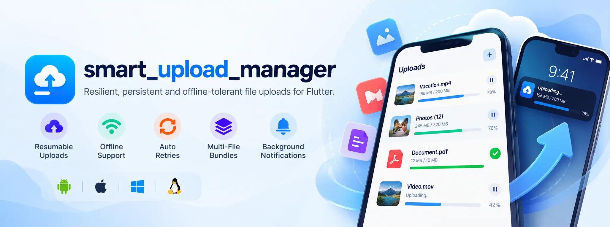

# Smart Upload Manager



A resilient, persistent, offline-tolerant file upload manager for Flutter with automatic retries, resumable chunked transfers, background notifications, and single & multi-file bundle upload support.

[](https://pub.dev)
[](LICENSE)
[](https://flutter.dev)

---


---

## ✨ Features

- 🛡️ **Crash-Resistant:** Atomic disk persistence ensures pending uploads survive app kills and device reboots.
- 📡 **Offline-Tolerant:** Automatically pauses on network loss and auto-resumes when connection is restored.
- 📦 **Single & Multi-File Bundles:** Upload individual files or bundle multiple files in a single request (`uploadMultiple`).
- ⚡ **Resumable Protocols:** Pluggable adapters for standard multipart, byte-range chunks, **Tus.io**, and **AWS S3**.
- 🔔 **Background Notifications:** System tray progress bar, transfer speed (MB/s), and ETA.
- 🔄 **Exponential Retries:** Automatic retries with randomized jitter to prevent server hammering.
- 🎛️ **Priority Queue:** Configurable concurrency limit and priority levels (`critical`, `high`, `normal`, `low`).
- 🧩 **Ready-to-Use UI:** Drop-in `UploadTaskTile` and `UploadProgressBar` widgets.

---

## 📱 Platform Setup

### iOS Setup

1. **Notification Delegate (`ios/Runner/AppDelegate.swift`)**:
   Ensure upload progress notifications display properly when the app is in the foreground or background:
   ```swift
   if #available(iOS 10.0, *) {
     UNUserNotificationCenter.current().delegate = self as? UNUserNotificationCenterDelegate
   }
   ```

2. **Minimum Deployment Target (`ios/Podfile`)**:
   Set iOS 14.0 or higher:
   ```ruby
   platform :ios, '14.0'
   ```

3. **Photo & File Permissions (`ios/Runner/Info.plist`)**:
   If picking files from the gallery or documents:
   ```xml
   <key>NSPhotoLibraryUsageDescription</key>
   <string>Allow access to select photos and videos for upload.</string>
   <key>NSDocumentPickerUsageDescription</key>
   <string>Allow access to upload selected documents.</string>
   ```

---

### Android Setup

1. **Permissions (`android/app/src/main/AndroidManifest.xml`)**:
   ```xml
   <!-- Required for network requests -->
   <uses-permission android:name="android.permission.INTERNET" />
   <uses-permission android:name="android.permission.ACCESS_NETWORK_STATE" />

   <!-- Required for progress notifications (Android 13+ / API 33+) -->
   <uses-permission android:name="android.permission.POST_NOTIFICATIONS" />

   <!-- Optional: foreground service notifications -->
   <uses-permission android:name="android.permission.FOREGROUND_SERVICE" />
   <uses-permission android:name="android.permission.FOREGROUND_SERVICE_DATA_SYNC" />
   ```

2. **Runtime Permission (Android 13+)**:
   Request notification permissions before starting uploads:
   ```dart
   final granted = await SmartUploadManager.instance.requestNotificationPermission();
   ```

---

## 🚀 Usage

### 1. Installation

Add to your `pubspec.yaml`:
```yaml
dependencies:
  smart_upload_manager: ^1.0.1
```

---

### 2. Initialize in `main()`

Optionally configure the queue, retry policy, and background notifications:

```dart
import 'package:flutter/material.dart';
import 'package:smart_upload_manager/smart_upload_manager.dart';

void main() async {
  WidgetsFlutterBinding.ensureInitialized();

  await SmartUploadManager.initialize(
    maxConcurrentUploads: 2,
    retryPolicy: const RetryPolicy(maxRetries: 3),
    notificationConfig: const NotificationConfig(
      enabled: true, // Set to false to disable system notifications completely
      channelId: 'smart_upload_channel',
      channelName: 'File Uploads',
      channelDescription: 'Ongoing file upload progress and speed',
    ),
  );

  runApp(const MyApp());
}
```

> **Note on Disabling Notifications:**
> If you prefer in-app UI only without system drawer notifications, pass:
> `notificationConfig: const NotificationConfig(enabled: false)`.

---

### 3. Upload a Single File

```dart
import 'dart:io';
import 'package:smart_upload_manager/smart_upload_manager.dart';

// One-liner upload with progress callback
final task = await SmartUploadManager.upload(
  file: File('/path/to/video.mp4'),
  url: 'https://api.example.com/upload',
  headers: {'Authorization': 'Bearer $token'},
  onProgress: (progress, speed, eta) {
    print('${(progress * 100).toInt()}% • $speed • ETA: $eta');
  },
  onSuccess: (task) => print('Uploaded: ${task.response}'),
  onError: (task, error) => print('Error: $error'),
);

// Or call directly on any File:
await File('/path/to/doc.pdf').upload(url: 'https://api.example.com/upload');
```

---

### 4. Upload Multiple Files in One Request (`uploadMultiple`)

Bundle multiple files into a single multipart HTTP request:

```dart
final task = await SmartUploadManager.uploadMultiple(
  files: ['/path/to/photo1.jpg', '/path/to/photo2.jpg'],
  url: 'https://api.example.com/upload/bundle',
  fileFieldName: 'files',
  onProgress: (progress, speed, eta) {
    print('Total bundle progress: ${(progress * 100).toInt()}%');
  },
  onSuccess: (task) => print('All files uploaded: ${task.response}'),
  onError: (task, error) => print('Error: $error'),
);
```

---

### 5. Pre-Built UI Widgets

Drop in animated widgets without writing `StreamBuilder` boilerplate:

```dart
// Complete task tile with progress bar, speed, pause/resume, and cancel controls
UploadTaskTile(
  task: task,
  onDismiss: () => SmartUploadManager.instance.deleteTask(task.id),
)

// Standalone auto-updating progress bar
UploadProgressBar(taskId: task.id)
```

---

### 6. Queue Management & Global Controls

```dart
// Global controls
SmartUploadManager.instance.pauseAll();
SmartUploadManager.instance.resumeAll();
SmartUploadManager.instance.cancelAll();
SmartUploadManager.instance.clearCompleted();

// Live queue summary stream
StreamBuilder<QueueSummary>(
  stream: SmartUploadManager.instance.queueSummaryStream,
  builder: (context, snapshot) {
    final summary = snapshot.data ?? SmartUploadManager.instance.summary;
    return Text('Active: ${summary.activeTasks} • Pending: ${summary.enqueuedTasks}');
  },
);
```

---

## 🔌 Supported Protocols

Pass `protocol` to `upload()` to select the adapter:

| Protocol | Enum | Usage |
| :--- | :--- | :--- |
| **Standard Multipart** | `UploadProtocol.standard` | Standard REST APIs (`POST`/`PUT`). *(Default)* |
| **Resumable Chunks** | `UploadProtocol.resumable` | Servers supporting `Content-Range: bytes START-END/TOTAL`. |
| **Tus.io** | `UploadProtocol.tus` | Open [tus.io](https://tus.io) servers (Vimeo, Cloudflare, tusd). |
| **AWS S3 Multipart** | `UploadProtocol.s3Multipart` | AWS S3 multi-part chunked uploads. |
| **Simulated** | `UploadProtocol.simulated` | Offline mock transfers for testing UI & notifications. |

---

## 📖 Example App

Check the [`example/`](example/) directory for a full demo showcasing single & bundle uploads, pause/resume, mock transfers, and the live queue dashboard.

```bash
cd example
flutter run
```

---

## License

MIT License. See [LICENSE](LICENSE) for details.
