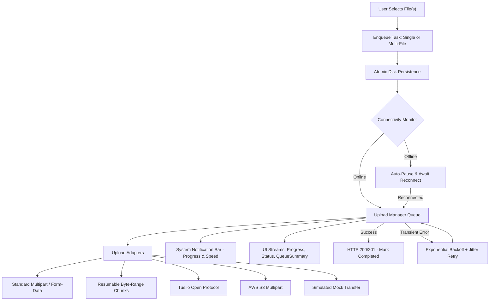

# smart_upload_manager

A resilient, persistent, offline-tolerant file upload manager for Flutter with automatic retries, resumable chunked transfers, background notifications, and single & multi-file bundle upload support.

[](https://pub.dev)
[](LICENSE)
[](https://flutter.dev)

---

## ✨ Features

- 🛡️ **Crash-Resistant:** Atomic disk persistence ensures pending uploads survive app kills and device reboots.
- 📡 **Offline-Tolerant:** Automatically pauses on network loss and auto-resumes when connection is restored.
- 📦 **Single & Multi-File Bundles:** Upload individual files or bundle multiple files in a single request (`uploadMultiple`).
- ⚡ **Resumable Protocols:** Pluggable adapters for standard multipart, byte-range chunks, **Tus.io**, and **AWS S3**.
- 🔔 **Background Notifications:** System tray progress bar, transfer speed (MB/s), and ETA.
- 🔄 **Exponential Retries:** Automatic retries with randomized jitter to prevent server hammering.
- 🎛️ **Priority Queue:** Configurable concurrency limit and priority levels (`critical`, `high`, `normal`, `low`).
- 🧩 **Ready-to-Use UI:** Drop-in `UploadTaskTile` and `UploadProgressBar` widgets.

---

## 🏗️ Architecture & Flow



---

## 🚀 Quick Start

### 1. Installation

```yaml
dependencies:
  smart_upload_manager: ^0.1.0
```

### 2. Upload a Single File

```dart
import 'dart:io';
import 'package:smart_upload_manager/smart_upload_manager.dart';

// One-liner upload with progress callback
final task = await SmartUploadManager.upload(
  file: File('/path/to/video.mp4'),
  url: 'https://api.example.com/upload',
  headers: {'Authorization': 'Bearer $token'},
  onProgress: (progress, speed, eta) {
    print('${(progress * 100).toInt()}% • $speed • ETA: $eta');
  },
  onSuccess: (task) => print('Uploaded: ${task.response}'),
  onError: (task, error) => print('Error: $error'),
);

// Or use the File extension directly:
await File('/path/to/doc.pdf').upload(url: 'https://api.example.com/upload');
```

### 3. Upload Multiple Files in One Request (`uploadMultiple`)

```dart
final task = await SmartUploadManager.uploadMultiple(
  files: ['/path/to/photo1.jpg', '/path/to/photo2.jpg'],
  url: 'https://api.example.com/upload/bundle',
  fileFieldName: 'files',
  onProgress: (progress, speed, eta) => print('${(progress * 100).toInt()}%'),
);
```

---

## 🎨 Pre-Built UI Widgets

Drop in animated UI widgets without boilerplate:

```dart
// Complete task tile with progress bar, speed, pause/resume, and cancel controls
UploadTaskTile(
  task: task,
  onDismiss: () => SmartUploadManager.instance.deleteTask(task.id),
)

// Standalone self-updating progress bar
UploadProgressBar(taskId: task.id)
```

---

## 🎛️ Queue Management & Configuration

```dart
// Optional initialization in main() (defaults apply automatically if omitted)
await SmartUploadManager.initialize(
  maxConcurrentUploads: 2,
  retryPolicy: const RetryPolicy(maxRetries: 3),
  notificationConfig: const NotificationConfig(enabled: true),
);

// Global controls
SmartUploadManager.instance.pauseAll();
SmartUploadManager.instance.resumeAll();
SmartUploadManager.instance.cancelAll();
SmartUploadManager.instance.clearCompleted();

// Live queue summary stream
StreamBuilder<QueueSummary>(
  stream: SmartUploadManager.instance.queueSummaryStream,
  builder: (context, snapshot) {
    final summary = snapshot.data ?? SmartUploadManager.instance.summary;
    return Text('Active: ${summary.activeTasks} • Pending: ${summary.enqueuedTasks}');
  },
);
```

---

## 🔌 Supported Protocols

Pass `protocol` to `upload()` to select the adapter:

| Protocol | Enum | Usage |
| :--- | :--- | :--- |
| **Standard Multipart** | `UploadProtocol.standard` | Standard REST APIs (`POST`/`PUT`). *(Default)* |
| **Resumable Chunks** | `UploadProtocol.resumable` | Servers supporting `Content-Range: bytes START-END/TOTAL`. |
| **Tus.io** | `UploadProtocol.tus` | Open [tus.io](https://tus.io) servers (Vimeo, Cloudflare, tusd). |
| **AWS S3 Multipart** | `UploadProtocol.s3Multipart` | AWS S3 multi-part chunked uploads. |
| **Simulated** | `UploadProtocol.simulated` | Offline mock transfers for testing UI & notifications. |

---

<details>
<summary><b>📱 Platform Setup (Android & iOS Permissions)</b></summary>

### Android
Add permissions in `android/app/src/main/AndroidManifest.xml`:
```xml
<uses-permission android:name="android.permission.INTERNET" />
<uses-permission android:name="android.permission.ACCESS_NETWORK_STATE" />
<uses-permission android:name="android.permission.POST_NOTIFICATIONS" />
```
*(Android 13+)*: Request runtime permission if using notifications:
```dart
await SmartUploadManager.instance.requestNotificationPermission();
```

### iOS
Set minimum deployment target in `ios/Podfile`:
```ruby
platform :ios, '14.0'
```
Add to `ios/Runner/Info.plist` (if picking from camera/gallery):
```xml
<key>NSPhotoLibraryUsageDescription</key>
<string>Allow access to select files for upload.</string>
```
</details>

---

## 📖 Example App

Check the [`example/`](example/) directory for a full demo showcasing single & bundle uploads, pause/resume, mock transfers, and the live queue dashboard.

```bash
cd example
flutter run
```

---

## License

MIT License. See [LICENSE](LICENSE) for details.
